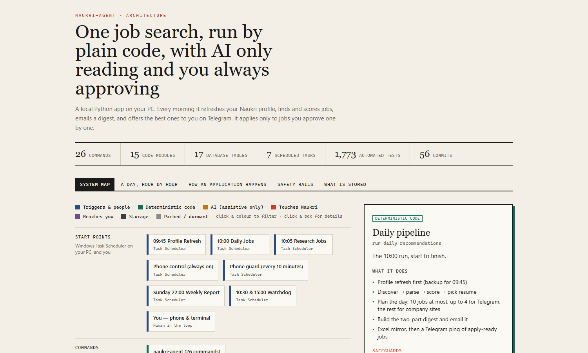
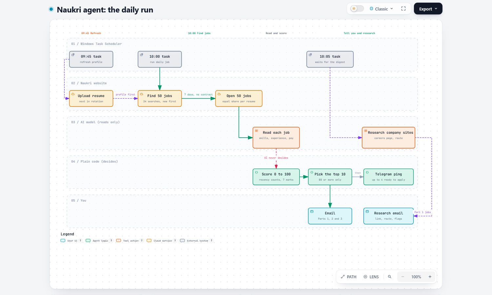
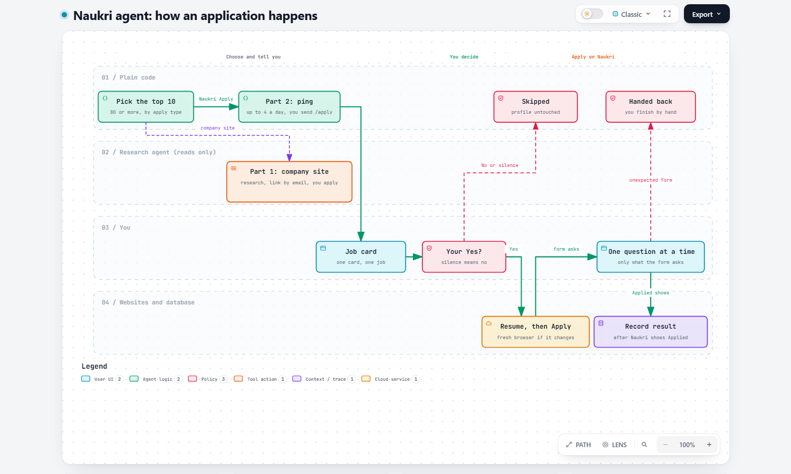
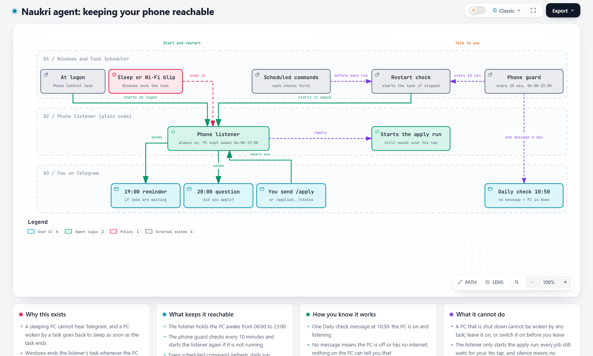
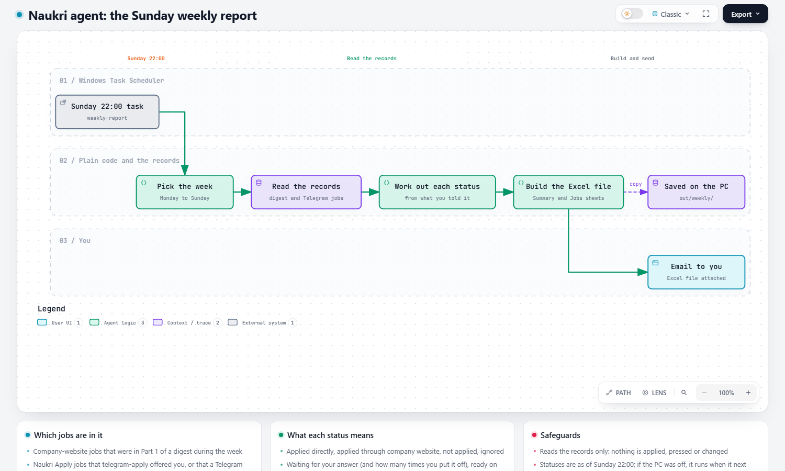

# naukri-agent

[](https://github.com/hemantmane2113/Agentic-Job-Search-Application-Automation-System/actions/workflows/tests.yml)


**A personal job-search assistant for [Naukri.com](https://www.naukri.com). Every day it finds fresh jobs, reads them, scores
them with plain code against your profile, emails you a digest, and tells your phone about the jobs it can apply to for you.
It applies only after you tap Yes on Telegram, one job at a time.**

> The AI reads. Plain code decides. A human approves every application.

## What it does

- **Finds and reads jobs.** It searches Naukri every morning, opens about 50 fresh jobs, and has a local AI model extract the
  skills, experience and salary from each posting (extraction only).
- **Scores them with arithmetic, not AI.** Seven categories add up to 100: skills 35, experience 20, role 15, salary 11,
  location 7, education 5, posted recently 7. A score of 80 or more is ACCEPT.
- **Sends you a daily digest** by email: the best jobs (at most 10) with the reasons for each score, the direct apply link for
  jobs that apply on the employer's own site, and where earlier jobs stand.
- **Applies for you, with your permission.** For jobs that use Naukri's own Apply button, your phone receives a card per job.
  Nothing is applied without your Yes tap on that job. Silence, No or a timeout means no.
- **Answers the application questions with you.** It asks you only what Naukri's form asks, one question at a time, on
  Telegram.
- **Researches company-site jobs.** A read-only AI agent finds the company's careers page and how applying works there.
- **Keeps a complete record.** Every application, question and answer is stored in a local database; a weekly Excel report
  is emailed every Sunday.
- **Stays reachable while you are away.** A phone listener, a 10-minute guard and a once-a-day "the PC is on" message keep
  `/apply` working from anywhere.

## See how it works

The interactive diagrams open as normal web pages through the links below. (GitHub shows an `.html` file as code, so use the
links or the pictures.)

| | |
|---|---|
| [](https://hemantmane2113.github.io/Agentic-Job-Search-Application-Automation-System/docs/architecture.html)<br>**[System map](https://hemantmane2113.github.io/Agentic-Job-Search-Application-Automation-System/docs/architecture.html)**<br>The parts, a day hour by hour, safety rails, what is stored | [](https://hemantmane2113.github.io/Agentic-Job-Search-Application-Automation-System/workflow-diagrams/workflow-daily-run.html)<br>**[The daily run](https://hemantmane2113.github.io/Agentic-Job-Search-Application-Automation-System/workflow-diagrams/workflow-daily-run.html)**<br>Finding, reading, scoring and telling you |
| [](https://hemantmane2113.github.io/Agentic-Job-Search-Application-Automation-System/workflow-diagrams/workflow-apply-flow.html)<br>**[How an application happens](https://hemantmane2113.github.io/Agentic-Job-Search-Application-Automation-System/workflow-diagrams/workflow-apply-flow.html)**<br>Your Yes tap, the right resume, the form's questions | [](https://hemantmane2113.github.io/Agentic-Job-Search-Application-Automation-System/workflow-diagrams/workflow-phone-reachability.html)<br>**[Keeping your phone reachable](https://hemantmane2113.github.io/Agentic-Job-Search-Application-Automation-System/workflow-diagrams/workflow-phone-reachability.html)**<br>Listener, guard, Daily check, reminders |
| [](https://hemantmane2113.github.io/Agentic-Job-Search-Application-Automation-System/workflow-diagrams/workflow-weekly-report.html)<br>**[The Sunday weekly report](https://hemantmane2113.github.io/Agentic-Job-Search-Application-Automation-System/workflow-diagrams/workflow-weekly-report.html)**<br>The weekly Excel report | |

## A day in its life

| Time | What happens |
|---|---|
| 09:45 | **Profile refresh.** Uploads the next of your resumes so your Naukri profile counts as freshly updated. |
| 10:00 | **Daily run.** Searches, reads about 50 fresh jobs, scores them, picks the top 10 (80 or more), emails the digest, pings Telegram. |
| 10:05 | **Research.** Researches the company-website jobs in the digest and emails what it found. |
| 10:30, 15:00 | **Watchdog.** Silent unless a morning step did not happen; then it alerts you on Telegram. |
| 10:50 | **Daily check.** One Telegram message: the PC is on and phone control is listening. No message means something is wrong. |
| 19:00 | **Reminder.** Lists the Naukri Apply jobs still waiting. Silent if none. |
| 20:00 | **"Did you apply?"** Asks about company-website jobs that have no answer yet. Silent if none. |
| Sunday 22:00 | **Weekly report.** An Excel file of every job given that week and its status, emailed to you. |
| Any time | **`/apply` from your phone** starts the apply run; a card per job arrives and nothing is applied without your Yes. |

## Principles

| Principle | How it is enforced |
|---|---|
| A human approves every application | Each job is sent to Telegram with Yes and No. Silence, No or a timeout means no. `/apply` only starts the run that asks. |
| The AI never decides | The scorer is pure arithmetic. The model only extracts fields from a posting or reads a company site. |
| The daily run cannot apply | Tests fail if the daily pipeline, discovery, scheduler, research agent or phone listener import any apply code. |
| No bypassing protections | CAPTCHA, MFA and rate limits are detected and handed to a human. No stealth, no evasion. |
| The database is the truth | Only the application history says what you applied to. Excel files are copies rebuilt from it. |
| Secrets stay local | Keys and passwords live in `.env`, which is git-ignored. Errors report only the exception type. |

## Quick start

You need **Python 3.12+**, a Naukri account, and [Ollama](https://ollama.com) running locally (or a Groq or OpenAI key).
Windows is the primary platform: the scheduling and keep-awake features use Windows Task Scheduler.

```bash
git clone https://github.com/hemantmane2113/Agentic-Job-Search-Application-Automation-System.git
cd Agentic-Job-Search-Application-Automation-System
python -m venv .venv
.venv\Scripts\activate            # macOS/Linux: source .venv/bin/activate
pip install -e ".[dev]"
playwright install chromium
cp .env.example .env              # then fill in your Naukri login and the other settings
naukri-agent doctor               # checks your setup and says exactly what is missing
naukri-agent run-daily            # one daily run: discover, read, score, write the digest
```

`DRY_RUN=true` and `AUTO_APPLY=false` are the defaults, so a first run reads and scores jobs and writes the digest to a file. It
applies to nothing and sends no email. The full walkthrough, with your profile, resumes, Telegram bot and email, is in
[docs/SETUP.md](docs/SETUP.md).

## Documentation

| Guide | What is in it |
|---|---|
| [docs/SETUP.md](docs/SETUP.md) | Installing, configuring your profile and resumes, Telegram, email and the AI models |
| [docs/OPERATIONS.md](docs/OPERATIONS.md) | Scheduled tasks, phone control, the weekly report, commands, pause switches and backups |
| [docs/TROUBLESHOOTING.md](docs/TROUBLESHOOTING.md) | `doctor`, where the logs and failure evidence are, and the problems seen so far |
| [docs/PROJECT_OVERVIEW.md](docs/PROJECT_OVERVIEW.md) | The design, the architecture, how applying works and where to look when something breaks |
| [CONTRIBUTING.md](CONTRIBUTING.md) | How to set up for development, the rules the code follows and how to submit a change |
| [CHANGELOG.md](CHANGELOG.md) | What changed and when |
| [SECURITY.md](SECURITY.md) | How to report a problem safely |

## Everyday commands

| Command | What it does |
|---|---|
| `naukri-agent doctor` | Check that the environment, profile, resumes and database are set up |
| `naukri-agent run-daily` | The daily run: discover, read, score, digest, Excel |
| `naukri-agent telegram-apply` | Offer ready Naukri Apply jobs to you on Telegram (needs `AUTO_APPLY=true`, `DRY_RUN=false`) |
| `naukri-agent telegram-listen` | Stay running so `/apply` from your phone starts the above |
| `naukri-agent research-jobs` | Research the company-website jobs in today's digest |
| `naukri-agent applications` | List the recorded applications |
| `naukri-agent mark-applied <job>` | Record an application you made yourself |
| `naukri-agent weekly-report` | Build and email the weekly Excel report |

All 26 commands are listed in [docs/OPERATIONS.md](docs/OPERATIONS.md).

## Project layout

```
src/naukri_agent/
  config.py            all settings, validated; the only place that reads the environment
  candidate/ resume/   your profile and resumes; selection among YOUR resume files
  jobs/                job models and the AI job parser (extraction only)
  matching/            the deterministic scorer
  llm/                 provider abstraction: Ollama (local), Groq, OpenAI
  browser/             Playwright: login, search, job pages, profile upload, the apply panel
  database/            SQLAlchemy models and repositories (SQLite)
  orchestration/       the daily run, apply runner, phone listener, follow-up, watchdog
  recommendations/     the digest builder and the apply-ready query
  research_agent/      the read-only company-site researcher
  notifications/       email (file, console, SMTP), Telegram
  reporting/           the Excel mirror and the weekly report
  cli/                 the `naukri-agent` command
tests/                 about 1,800 tests; no real browser or network needed
docs/  workflow-diagrams/   guides and the interactive diagrams
```

## Tech stack

Python 3.12+, Click, SQLAlchemy and SQLite, Playwright (Chromium), Pydantic, Ollama (local parsing), Groq (company research),
OpenAI (optional), OpenPyXL (Excel), APScheduler (optional), the Telegram Bot API, and Windows Task Scheduler.

## Testing

```bash
pytest
```

The default run uses fake browser pages and needs no network or credentials: currently **1,773 passed, 3 deselected**. Tests
that need a real Naukri account are marked `manual` and are excluded unless you run `pytest -m manual`.

## Status and limits

Stated plainly, so nobody is surprised:

- **Built for one person on one Windows PC.** It is a personal tool, not a hosted service, and it works with Naukri only.
- **The apply form is the fragile part.** Naukri's question panel varies. The code handles each kind seen so far and stops
  cleanly with a saved screenshot when it meets a new one. The newest "answer what the form asks" flow has been tested only
  against scripted copies of the real page, so treat it as unproven until it has run on a real application.
- **It depends on Naukri's pages.** A site change can break a selector. All of them live in one file, marked VERIFIED
  (with a date) or UNVERIFIED.
- **A shut-down PC cannot run anything.** The guard and the daily check exist so you notice.

## Responsible use

This project automates your own Naukri account for your own job search. Automated access may be restricted by Naukri's terms
of service, and you are responsible for using it in line with them. It deliberately avoids anything that would evade a site's
protections: it never solves a CAPTCHA, never works around MFA or rate limits, and never presses "Apply on company site"
(Naukri marks the job as applied when that button is pressed). It is not affiliated with or endorsed by Naukri.com or Info Edge.

## Contributing and license

Issues and pull requests are welcome; start with [CONTRIBUTING.md](CONTRIBUTING.md). Released under the [MIT License](LICENSE).
